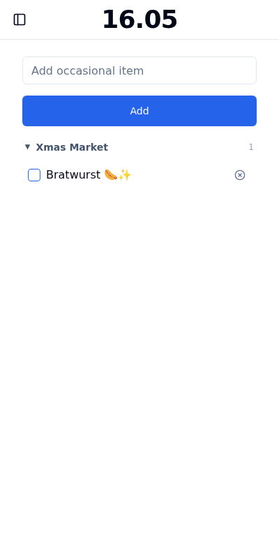

# Checked

Minimalistic, local-first list app. Still great for grocery shopping — organize items into **Lists**, group related Lists into a **Notebook**, and keep all your Notebooks in your **Library**.

> The app is in its pr
e-pre-alpha stage. You can try it at https://checked-95k.pages.dev/. Please, remember
that the demo version uses public automerge sync server and the data can be erased at any time.

Forked from original project https://github.com/nonscalable/OnlyGroceries

Note:  This project utilized AI heavily for changes to the original project.

## Goals

- Minimalistic app with clear functionality.
- Local-first. The app works even if there is no internet connectivity.

## Concept

Checked organizes your items into three levels:

- **List** — a named, ordered set of items (a grocery run, a packing list, anything). `Common items` is a special always-present List for things you buy often.
- **Notebook** — a collection of Lists that sync together as one document. This is what you create, name, and switch between.
- **Library** — every Notebook your browser knows about. You can export/import your whole Library as a backup or to move between devices.

### Main Page

The `Shopping List` page is the focus of the application. Items can be added by entering them into the text box, or picked from the `Common items` List or any of your other Lists in the sidebar.

Items can be added, edited, removed, rearranged, or moved to a different List within each of the Lists. Items added to the `Shopping List` that aren't included in other Lists can be moved to a List at any time from the `Shopping List`.

This makes the following workflow:

1. You add your regular items to a List.
2. Before going to the shop, you click on the item you're going to buy.
3. Once you're in the shop, switch to the `Shopping List` tab to see only the items you need. No distractions!
4. The `Shopping List` will show all items added from across all your Lists and provide them in foldable sections for organization.

### Lists

Multiple Lists can be managed from the side bar. Lists can be reorganized by dragging and dropping. Any item from a List can be added to the shopping list the same way as items from `Common items`.

### Settings Page

Light and Dark mode are available along with personalized color highlighting for themes.

Create multiple Notebooks and easily switch between them.

Export a backup of your Library (the Notebook id's saved in your browser) to import within another browser or share with another user. Every Notebook in your browser will be exported. If you do not want to share every Notebook with someone, use the Copy/Share button to share a single Notebook.

## Self Hosting

It's recommended to install this using the docker-compose.yaml

There is no security built in to the application.  It is recommended you use something like Cloudflare Access or Tailscale to access your Checked list when away.

To use the sync server included in the docker compose file, use the address `wss://your-server.example.com?access-token=Secret-Token` within the settings page.  Replace `Secret-Token` with the text you chose in the docker compose file.  Use `ws://` for an ip address without encryption and `wss://` for an address that uses a certificate.

## Admin Portal

The server now includes an admin portal on a separate port.  By default in `docker-compose.yaml`, it is exposed on `5175` and maps to server `ADMIN_PORT=8081`.

Set a dedicated admin token with `ADMIN_TOKEN`, then open `http://your-server:5175` and enter the token.

The admin portal allows you to:

- View all stored notebook ids
- Inspect last accessed and last modified timestamps
- View notebook content JSON for each notebook
- Delete notebooks
- Prune old notebooks by inactivity age with a dry-run preview
